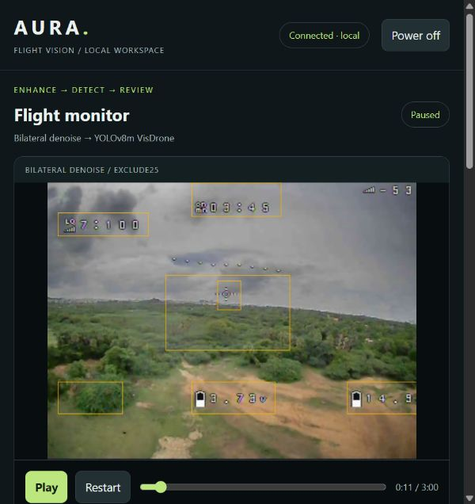

# major_project — AURA Flight Vision

A local FPV video workspace: **video / USB camera → image enhancement → object detection → review**.

The main detector is the existing Kaggle-trained **YOLOv8m VisDrone** model. The dashboard includes eight enhancement methods, selectable FPV telemetry exclusion, original/processed comparison, video upload, camera input, playback controls, power on/off, and downloadable review snapshots.



## Quick start for your friend — Windows

1. Install **64-bit Python 3.11** from [python.org](https://www.python.org/downloads/windows/). Include the Python launcher (`py`) during installation.
2. Get the **whole project**, including its models and sample videos:

   ```powershell
   git clone https://github.com/7-Azhar/major_project.git
   cd major_project
   ```

   Or choose **Code → Download ZIP** on GitHub, then extract the ZIP completely. Do not run the launchers inside the ZIP. This repository includes large model/video assets, so downloading takes longer than a code-only project. Git LFS and submodules are not required.

3. Double-click **Setup AURA.cmd**. Keep the window open while it downloads packages, creates `ML/.venv-portable`, checks the bundled assets, and tests both detection and Zero-DCE. The first setup needs internet and several GB of free space; CUDA packages are particularly large.
4. When setup reports success, double-click **Start AURA.cmd**. Your browser opens **http://127.0.0.1:8766/**.
5. Keep the launcher window running. Choose a recording or camera, choose enhancement/detection settings, and press **Play**.

**Do not copy someone else's `.venv` folder.** Setup creates a fresh environment for this laptop. No administrator privileges, Node.js server, API key, paid API, or cloud video service is needed. Python packages and drivers still have to be available on the machine.

The launchers prefer an existing `ML/.venv` when present, preserving the original development laptop. A fresh clone has no such folder and uses the new `ML/.venv-portable` instead. If both exist and you want the new environment explicitly:

```powershell
.\ML\.venv-portable\Scripts\python.exe ML/dashboard.py --port 8766 --open-browser
```

## Hardware setup

Setup detects NVIDIA devices using `nvidia-smi`. It chooses the established CUDA 12.1 / PyTorch 2.5.1 environment for RTX 20/30/40-series machines, including the RTX 4050, or CPU packages when no NVIDIA device is detected. Detected RTX 50-series devices select the CUDA 12.8 / PyTorch 2.7.1 pair. The actual device is tested by tensor execution and real model inference before setup succeeds.

For an explicit choice, use these instead of double-clicking Setup:

```powershell
# NVIDIA GPU, including RTX 2050 / RTX 4050
py -3.11 setup_aura.py --device cuda
# CPU only, including laptops without a supported NVIDIA GPU
py -3.11 setup_aura.py --device cpu
# Explicit newer CUDA package pair; requires a compatible NVIDIA driver
py -3.11 setup_aura.py --device cuda --cuda-channel cu128
# Inspect the selected commands without installing anything
py -3.11 setup_aura.py --plan
```

These pinned pairs follow the [official PyTorch installation commands](https://docs.pytorch.org/get-started/previous-versions/). They are reproducibility choices, not a claim to be the newest versions. For other GPU generations or driver issues, consult the [current PyTorch selector](https://pytorch.org/get-started/locally/) and [advanced setup guide](ML/PORTABLE_SETUP.md). CPU processing is slower. No fixed FPS is promised across laptops, input resolutions, or enhancement methods. RTX 2050 and CPU paths have been exercised here; the friend's actual RTX 4050/other hardware still needs the included startup check.

## Use the dashboard

- **Input:** select a saved recording, upload a local video up to 1 GB, or connect Camera 0–9. A USB FPV receiver must appear as a standard camera/capture device. These numbers are indexes, not a list of detected cameras.
- **Enhancement:** Original/raw, CLAHE, Unsharp, Bilateral, FPV restoration, Zero-DCE, FPV hybrid, or FPV restoration v2.
- **Detection:** Off; Original at 0.25 with exclusion disabled; Exclude telemetry at 0.25; or Exclude telemetry at 0.50. Exclusion works on every input and stays selected when you change source.
- **Amber outlines:** check that the scaled exclusion regions align with your FPV telemetry. This is a geometric profile, not automatic calibration. It can hide real small targets. Use Original to turn exclusion off completely.
- **Power off/on:** stops/resumes processing; it does not shut down the computer or unload all model memory. Play/Pause is separate. Ctrl+C in the launcher stops the service.
- **Save review frame:** downloads one HTML file containing the displayed input/output images, settings, hardware, detections, and exclusion reasons. It opens later without the server. It is not a video export.
- **Full screen:** enlarge the monitor; use Exit full screen to return. On small screens use Input & settings to reach the controls.

Video processing stays on the laptop. The server listens only on `127.0.0.1`, so each friend runs their own local instance. All browser tabs on one server share the same pipeline. RTSP, proprietary receiver SDKs, remote hosting, drone flight control, and a browser video recorder are not implemented.

See the [dashboard guide](ML/DASHBOARD_GUIDE.md) for detailed controls, timing interpretation, buffering, and recovery behavior.

## What is included

| Location | Purpose |
| --- | --- |
| `ML/dashboard.py`, `ML/dashboard/` | Local server and the working dashboard |
| `ML/frame_processor.py`, `ML/hardware.py`, `ML/video_sources.py` | Enhancement/detection processing, hardware selection, camera/file adapters |
| `feeed enhancement/app/` | Complete existing enhancement engine; preserve the folder spelling |
| `ML/models/yolov8m_visdrone_recovered.pt` | The actual trained VisDrone baseline, ready for inference |
| `feeed enhancement/outputs/models/Epoch99.pth` | Pretrained Zero-DCE checkpoint used by the dashboard |
| `ML/models/yolo11s.pt`, `yolo26n.pt`, `yolo26s.pt` | Alternative pretrained experiment models |
| `feeed enhancement/outputs/models/*.onnx` | Optional legacy enhancement exports; not required by the dashboard |
| `feeed enhancement/samples/`, root video files | FPV recordings and synthetic/degraded samples for reproducing outputs |
| `ML/profiles/` | Scalable FPV exclusion profile |
| `ML/train_cbam.py`, `ML/aura_cbam.py` | Corrected CBAM training experiment code |
| `feeed enhancement/scripts/`, `tests/`, `ML/test_*.py` | Evaluation, export, benchmarking, and regression tools |
| `reports/` | Selected existing reports and review images, with their original limitations |
| `assets-manifest.json` | Sizes and SHA-256 hashes of required model/demo assets |
| `index.html` in the root | Earlier static prototype; use Start AURA for the functional application |

The enhancement source is included as normal files, not a submodule. Installed Python libraries, local environments, caches, temporary uploads, the extracted duplicate checkpoint archive, and the large third-party dataset are excluded. They are not required for dashboard inference. Generated video/log archives can be recreated with the supplied scripts; selected reports are included in `reports/`.

## Generate further outputs

Run these from the project root after setup. The examples use the new portable environment; the PowerShell launchers can also locate the original `.venv` automatically.

### Export a detection video and logs

```powershell
.\ML\.venv-portable\Scripts\python.exe ML/detect_video.py --source "feeed enhancement/samples/fpv/real_fpv_user_flight.mp4" --output ML/outputs/my_first_review --max-frames 300 --device cuda
```

For a CPU installation, replace `--device cuda` with `--device cpu`. Use a **new output directory for every run**. The command exports raw-input detections, an annotated video, frame previews, `detections.jsonl`, and `report.json`; it is separate from the dashboard's selected enhancement. Add `--osd-profile ML/profiles/user_flight_osd.json` for exclusion on the calibrated 640×480 sample. The standalone exporter keeps strict profile dimensions.

For enhancement experiments, from `feeed enhancement` run the included engine or benchmark scripts with the portable Python executable:

```powershell
cd "feeed enhancement"
..\ML\.venv-portable\Scripts\python.exe main.py --help
..\ML\.venv-portable\Scripts\python.exe -m scripts.manual_viewer --help
cd ..
```

The optional legacy ONNX viewer may require additional ONNX Runtime packages/providers. The main web dashboard uses PyTorch for Zero-DCE and needs no ONNX Runtime installation. Older diagnostic scripts and historical reports can describe the original workstation; use the current dashboard/setup guides for a new laptop.

### Compare model experiments

```powershell
.\ML\run_model_experiment.ps1 -Experiment 1
.\ML\run_model_experiment.ps1 -Experiment 2
.\ML\run_model_experiment.ps1 -Experiment 3
.\ML\run_model_experiment.ps1 -Experiment 4
# Optional CPU selection:
.\ML\run_model_experiment.ps1 -Experiment 2 -Device cpu
```

1 = user-trained VisDrone YOLOv8m; 2 = COCO YOLO11s; 3 = COCO YOLO26n; 4 = COCO YOLO26s. The alternatives remain separate from the main dashboard. They have different class sets and have not been fine-tuned on this FPV footage. The viewer records session settings and prediction/mode logs under `ML/outputs/interactive_*`; keys 1/2/3 switch exclusion modes, Space pauses, R restarts, Q exits.

### Continue training or evaluation

The recovered checkpoint has **no CBAM modules** despite the original Kaggle output name. Corrected training code inserts and verifies attention modules during model construction; a full corrected CBAM training run has not been completed.

To train, obtain the VisDrone training/validation data separately, prepare its YOLO dataset YAML, and run `ML/train_cbam.py --help`. A complete training dataset is not included in this repository. The older `feeed enhancement/scripts/download_visdrone.py` downloads only a validation dataset; it is not a replacement for the training split. See [model provenance and training notes](ML/README.md) before reporting results.

Use a labelled FPV evaluation set to compare accuracy. Saved training metrics and detection counts on unlabelled video do not prove live FPV accuracy. Telemetry filtering, missed objects, tree/background false positives, and new overlay layouts remain limitations.

## Where new files go

- Browser uploads: `ML/uploads/` (local copies, retained across restarts).
- Review-frame downloads: your browser's download folder.
- Detection videos, logs and experiments: the chosen `ML/outputs/...` directory.
- Legacy enhancement recordings/reports: `feeed enhancement/outputs/`.
- Reference reports supplied with this handoff: `reports/`.

Generated folders are ignored by Git so later uploads and experiment results are not accidentally published. Model files listed in this repository are already tracked; avoid replacing the baseline weights when starting a new experiment.

## Verify the installation

```powershell
.\ML\.venv-portable\Scripts\python.exe ML/verify_setup.py
.\ML\.venv-portable\Scripts\python.exe -m pytest ML/test_osd_filter.py ML/test_detection_modes.py ML/test_video_sources.py ML/test_hardware.py ML/test_dashboard_runtime.py ML/test_setup.py -q
cd "feeed enhancement"
..\ML\.venv-portable\Scripts\python.exe -m pytest tests -q
cd ..
```

For dashboard integration checks, start a separate test server on port 8767, then run `ML/check_dashboard.py --port 8767`. Those checks change the source and playback settings, so do not target a live session you want to preserve. Tests use simulated cameras; physical USB capture must be checked with the actual receiver.

## Troubleshooting

| Problem | What to do |
| --- | --- |
| Python launcher missing | Install 64-bit Python 3.11 with the `py` launcher; run Setup again. |
| Package download interrupted | Check internet and free disk space; rerun Setup. It reuses the isolated environment. |
| CUDA unavailable / driver error | Update the NVIDIA driver as appropriate, inspect `nvidia-smi`, and use the official PyTorch selector. `--device cpu` is an explicit fallback. |
| Missing or changed model/demo asset | Run `ML/verify_setup.py --assets-only`; restore the named file from the repository. |
| PowerShell scripts blocked | Use the `.cmd` launchers or direct Python examples; no permanent execution-policy change is necessary. |
| Port 8766 already occupied | Start AURA reopens an existing AURA service. For another application on that port, launch `ML/dashboard.py --port 8768 --open-browser`. |
| Camera unavailable | Try the correct device index; close other camera apps; check Windows camera permissions and USB connection. |
| Wrong telemetry excluded | Inspect the amber regions. Switch to Original or customize a profile for the new overlay layout. |
| Slow processing / out of memory | Use raw or a lighter enhancement, smaller input footage, or FP32 only if needed for compatibility. CPU is slower. Close other GPU-heavy apps. |
| Blank page from opening HTML | Start the Python service and use its HTTP address. |

## Third-party components

Ultralytics models/software and Zero-DCE retain their upstream terms. See [Ultralytics](https://github.com/ultralytics/ultralytics), [Zero-DCE](https://github.com/Li-Chongyi/Zero-DCE), and [VisDrone](https://github.com/VisDrone/VisDrone-Dataset) for source, attribution, and dataset/model terms. This repository does not replace those licenses. The included reports are development observations, not flight-safety certification.